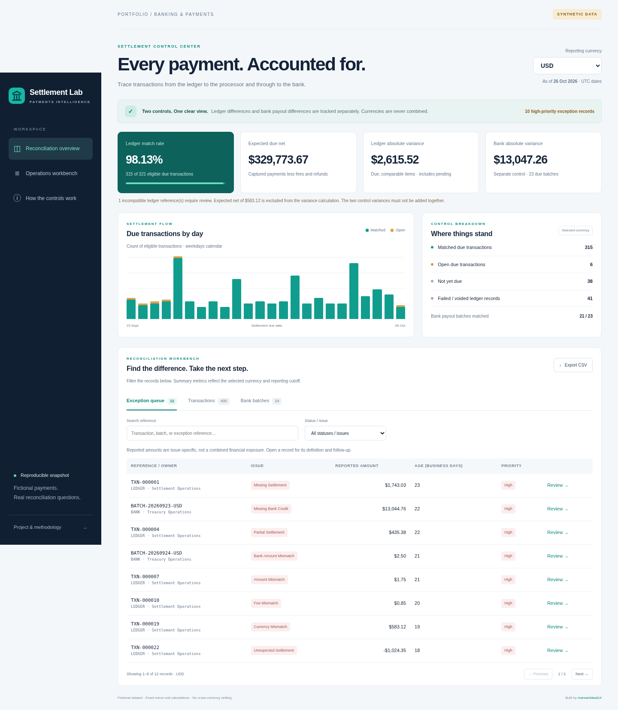
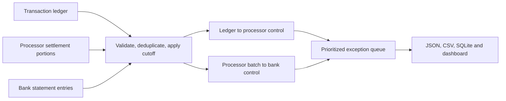

# Banking Transactions & Settlement Reconciliation Analytics

**Python · SQL · SQLite · Payments Operations · Interactive Dashboard**

An end-to-end portfolio project that follows a payment from the transaction ledger to processor settlement and then to the bank. It separates timing differences, incomplete settlement, fee discrepancies, and unmatched bank cash into an actionable exception queue.

**All records are synthetic.** No bank integration, real customer data, recovered funds, or production deployment is claimed.

[Open the web dashboard](https://marwanfaisal14.github.io/Banking-transactions-settlement-reconciliation-analytics/) · [Download the Power BI source package](powerbi/BankingReconciliation-PowerBI.zip) · [Power BI opening instructions](powerbi/README.md) · [العربية](README.ar.md)

**Power BI file status:** a self-contained `.pbip` source project now defines three pages, 32 native visual containers, an embedded synthetic snapshot, six tables, and 21 DAX measures. Its source structure and schemas are checked; Power BI Desktop loading/refresh/rendering and DAX execution are unverified. **No `.pbix` has been created.** Open and validate the source on Windows, then use Save As → Power BI file (*.pbix). Do not rename the extension.



## Business problem

A successful payment is not the same as settled cash. A processor can settle an incorrect amount, charge an unexpected fee, split a payment across records, or include a transaction missing from the internal ledger. A processor batch can also reconcile correctly to the ledger while the corresponding bank payout is missing or short.

This project answers four questions:

1. Which eligible transactions reconcile to the processor, and which need investigation?
2. Which processor batches reconcile to bank entries?
3. Is a difference caused by timing, amount, fee, currency, identity, or missing reference?
4. What should Settlement, Treasury, or Data Operations do next?

## What is included

| Deliverable | Details |
| --- | --- |
| Fictional source feeds | 1,200 ledger transactions across USD, AED, and EGP; processor settlement portions; signed bank entries |
| Reconciliation engine | Exact references, signed refunds, finality, split settlements/credits, fee rules, cutoff replay, and duplicate controls |
| SQL analysis | 12 executable analyses covering match rates, fees, aging, bank gaps, exception ownership, and financial conservation |
| Dashboard | Currency isolation, due-date chart, prioritized queue, transaction/batch views, search, filters, pagination, review dialogs, CSV export, and mobile layout |
| Audit artifacts | Source SHA-256 hashes, input counts, excluded future rows, CSV exports, local SQLite database, and a reproducible JSON snapshot |
| Validation | 28 engine/pipeline tests, five Power BI source-package checks, official PBIP/PBIR schema validation, and functional Chromium checks |

## Verified demonstration results

Fixed reporting cutoff: **26 October 2026**, using UTC dates. The synthetic calendar counts Monday–Friday only; public holidays are not modeled.

| Currency | Eligible due transactions | Matched | Count match rate | Expected due net | Ledger absolute variance | Bank absolute variance |
| --- | ---: | ---: | ---: | ---: | ---: | ---: |
| USD | 321 | 315 | 98.13% | 329,773.67 | 2,615.52 | 13,047.26 |
| AED | 328 | 322 | 98.17% | 352,642.09 | 4,399.01 | 9,910.90 |
| EGP | 322 | 316 | 98.14% | 351,260.44 | 3,530.63 | 14,677.98 |

These rates reflect deliberately planted demonstration cases, not operational performance. The two variance columns are independent controls and **must not be added together**. Comparable due items include pending items within grace; future-due items are excluded. Each currency also has one incompatible ledger reference, excluded from monetary variance and flagged separately. See [generated findings](docs/findings.md) and [metric definitions](docs/metrics.md).

## Run locally

The reconciliation pipeline uses the Python standard library. **No package installation or database server is required.** Python 3.12 is validated locally; CI is configured for 3.11 and 3.12.

```bash
git clone https://github.com/marwanfaisal14/banking-transactions-settlement-reconciliation-analytics.git
cd banking-transactions-settlement-reconciliation-analytics
python -m payments_analytics build
python -m unittest discover -v
python -m http.server 8000 --directory docs
```

Open the server's address in your local browser. The dashboard must be served over HTTP because it loads a JSON snapshot; opening `index.html` directly as a file is insufficient.

The fictional input files are committed. To recreate them exactly:

```bash
python -m payments_analytics generate --seed 20261026 --count 1200
python -m payments_analytics build --as-of 2026-10-26 --grace-days 1
```

Use `python -m payments_analytics build --help` for alternative input/output locations. A new `--as-of` value replays all three feeds at that cutoff. Future-dated processor and bank events are excluded even when present in the source files.

## Reconciliation design



Amounts are integer minor units. Positive payments and negative refunds reconcile using exact signed gross, fees, and net. An identical import ID is ignored with an audit event; a conflicting ID fails the run. Distinct settlement portions and split bank entries remain legitimate records. Amount-only fuzzy matching and cross-currency netting are disabled.

Settlement is modeled as T+2 business days; bank payout as T+1 after the latest portion in a batch; exception escalation uses one additional business day of grace. These are explicit fictional contract rules, not a universal banking standard.

## Explore the evidence

- [Generated findings](docs/findings.md) and [case study](docs/case-study.md).
- [Matching rules](docs/matching-rules.md), [metrics](docs/metrics.md), and [data dictionary](docs/data-dictionary.md).
- [SQL analyses](sql/analysis.sql) and [test suite](tests/test_engine.py).
- Ready-to-inspect exports: [ledger reconciliation](docs/data/transaction_reconciliation.csv), [bank batches](docs/data/batch_reconciliation.csv), [exceptions](docs/data/exceptions.csv).
- [Data provenance](data/README.md), [operations runbook](docs/runbook.md), and [Power BI integration guide](docs/power-bi-guide.md).
- [Mobile screenshot](docs/assets/dashboard-mobile.png).

Generated local outputs are ignored by Git: `outputs/reconciliation.sqlite`, three reconciliation CSVs, and `analysis-01.csv` through `analysis-12.csv`. Browser-ready snapshots and result CSVs under `docs/data` are committed so reviewers can inspect results without running Python.

## Browser validation

The browser test dependency is optional and is not needed by the engine or dashboard:

```bash
python -m pip install -r requirements-dev.txt
python -m playwright install chromium
python scripts/browser_smoke.py
```

If Chromium is already installed, pass `--browser /path/to/chromium`. Pass `--screenshots docs/assets` to refresh the README previews. Checks exercise actual filtering, record details, CSV download contents, pagination, keyboard tabs, mobile width, data-load errors, and retry recovery.

## Publish the dashboard with GitHub Pages

After the repository is on GitHub, open **Settings → Pages**, choose **Deploy from a branch**, select **main** and **/docs**, then save. GitHub supplies the site URL after deployment. Check that URL before presenting it as live. The dashboard is static and requires no API key or backend.

## Boundaries and next steps

This is an explainable demonstration, not a production accounting ledger. Country-specific holidays, FX conversion, chargebacks, reserves, rolling settlement adjustments, payout-SLA breach classification, incremental ingestion, and case-resolution persistence are outside this version. A real implementation would need provider-specific contracts, source controls, and an agreed operational calendar. See [the runbook](docs/runbook.md).

The [Power BI project](powerbi/README.md) includes native report/model source and embedded data. It is not a PBIX binary, and its DAX/Power Query expressions have not been executed in Desktop here. The [integration guide](docs/power-bi-guide.md) also explains manual import and financial validation.

## Portfolio relevance

Demonstrates SQL analysis, payment-lifecycle reasoning, reconciliation control design, exception triage, exact monetary calculations, reproducibility, automated validation, and communication of metric limitations. It supports discussions for **Data Analyst, BI Analyst, Power BI Developer, Payments Analyst, and Reconciliation Analyst** roles.

Licensed under [MIT](LICENSE), including the fictional demo data. Project owner: [marwanfaisal14](https://github.com/marwanfaisal14).
